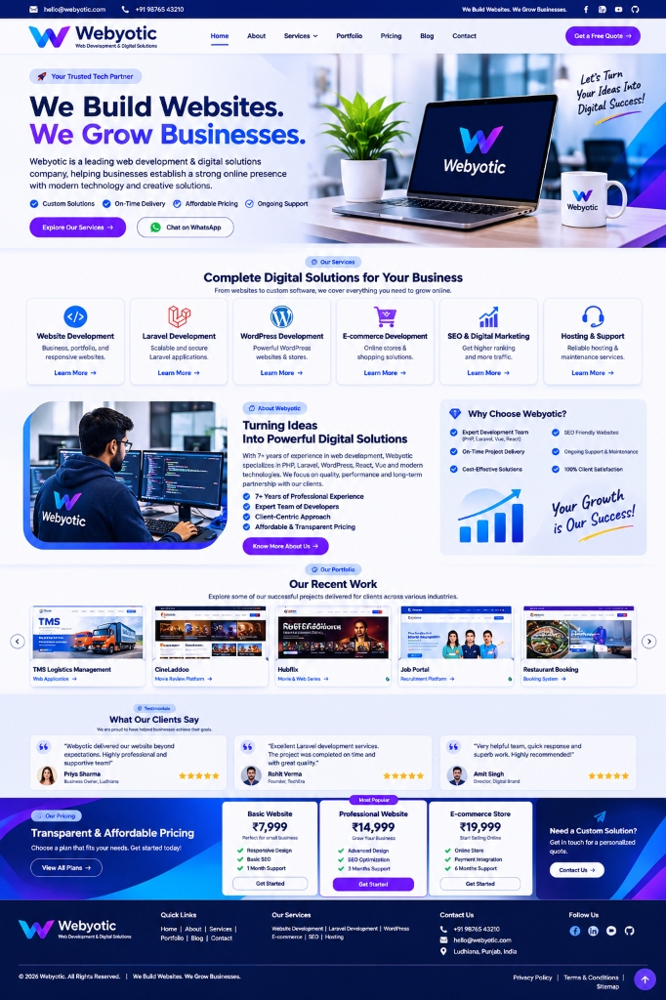

<div align="center">

# 🚀 Webyotic - Web Development & Digital Solutions
### *We Build Websites. We Grow Businesses.*

[](https://laravel.com)
[](https://react.dev)
[](https://tailwindcss.com)
[](https://php.net)
[](https://render.com)
[](LICENSE)

<br/>

[](https://render.com/deploy)

---

### 📸 Visual Design Showcase



</div>

---

## 📖 Overview

**Webyotic** is a production-ready, high-converting digital agency landing page built with **Laravel 13**, **React.js 19**, and **Tailwind CSS v4**. It features modern micro-interactions, an instant project quote estimator, a lead capture system connected to a SQLite/MySQL database, interactive case study modals, and 1-click **Render** cloud deployment configuration.

---

## ✨ Features

- 🎯 **Pixel-Perfect Visual Hierarchy**: High-contrast typography with DM Sans & Plus Jakarta Sans, vibrant gradients, and subtle glassmorphism.
- 📱 **100% Mobile & Tablet Responsive**: Seamlessly adapts from small mobile screens (320px) to ultra-wide 4K desktop displays.
- 💬 **WhatsApp & Direct Calling**: One-click WhatsApp consultation integration with pre-filled enquiry messages.
- 🛠️ **Interactive Services Showcase**: 6 core service modules (`Website Development`, `Laravel Development`, `WordPress Development`, `E-Commerce`, `SEO & Marketing`, `Hosting & Support`) with popup detail modals.
- 💼 **Filterable Portfolio Carousel**: Interactive project category filter with case studies (`TMS Logistics Management`, `CineLaddoo`, `Hubflix`, `Job Portal`, `Restaurant Booking`, `QuickShop E-Commerce`).
- 💰 **Transparent Pricing with Currency Switcher**: Real-time switch between **INR (₹)** and **USD ($)** pricing.
- 🧮 **Instant Interactive Quote Estimator Modal**: Prospective clients can configure project scope, pages, and addons to calculate an estimated budget.
- 📬 **Live Lead Generation System**: Validated contact form connected to Laravel API endpoint (`/api/contact`) with database persistence and celebration confetti.
- ⚡ **Zero-Config Standalone HTML Option**: Includes `public/landing.html` and `public/index_standalone.html` for instant client previews without running a web server.
- ☁️ **Render Cloud Deployment Ready**: Preconfigured with `render.yaml`, `Dockerfile`, `build.sh`, and `/health` monitoring.

---

## 🛠️ Tech Stack

| Layer | Technology |
|---|---|
| **Backend Framework** | Laravel 13.x (PHP 8.4) |
| **Frontend UI** | React 19.x & Vite 8 |
| **Styling** | Tailwind CSS v4.0 |
| **Icons** | Lucide React |
| **Database** | SQLite (Default for zero-config deployment) / MySQL |
| **Animations** | CSS Keyframes & Canvas-Confetti |
| **Deployment** | Render Web Services (Docker & Native PHP Runtime) |

---

## 📂 Project Directory Structure

```plaintext
webyotic-home/
├── app/
│   ├── Http/Controllers/
│   │   └── ContactController.php   # Handles contact form submissions & health check
│   └── Models/
│       └── ContactLead.php         # Eloquent Model for client enquiries
├── config/                         # Laravel application configs
├── database/
│   └── migrations/                 # Migrations including contact_leads table
├── docs/
│   └── preview.jpg                 # Full visual design preview
├── public/
│   ├── build/                      # Compiled production CSS & JS assets
│   ├── landing.html                # Standalone single-file HTML preview
│   └── index_standalone.html       # Static client distribution
├── resources/
│   ├── css/
│   │   └── app.css                 # Tailwind CSS v4 & custom utility layer
│   ├── js/
│   │   ├── app.jsx                 # React root mount entry point
│   │   └── LandingPage.jsx         # Full interactive React application
│   └── views/
│       └── landing.blade.php       # Blade wrapper with SEO meta tags & Vite tags
├── routes/
│   └── web.php                     # Web routes (/, /api/contact, /health, /up)
├── build.sh                        # Production Render deployment build script
├── DEPLOYMENT.md                   # Step-by-step deployment guide
├── Dockerfile                      # Multi-stage production container
├── render.yaml                     # Render 1-click Blueprint configuration
└── vite.config.js                  # Vite configuration for Laravel + React + Tailwind
```

---

## ⚡ Quick Start (Local Setup)

### Prerequisites
- **PHP** >= 8.2 (PHP 8.4 recommended)
- **Composer** >= 2.0
- **Node.js** >= 20.x and **npm**

### 1. Clone the repository
```bash
git clone https://github.com/VNKM92/webyotic-home.git
cd webyotic-home
```

### 2. Install PHP and Node dependencies
```bash
composer install
npm install
```

### 3. Setup environment and database
```bash
cp .env.example .env
php artisan key:generate
touch database/database.sqlite
php artisan migrate
```

### 4. Build assets and start development server
```bash
# Build frontend assets
npm run build

# Start Laravel backend server
php artisan serve
```

Visit **[http://127.0.0.1:8000](http://127.0.0.1:8000)** in your browser!

> **Live React Development**: Run `npm run dev` in a separate terminal for Hot Module Replacement (HMR).

---

## ☁️ Deploy to Render in 2 Steps

### Option A: Render 1-Click Blueprint (Recommended)
1. Go to [dashboard.render.com](https://dashboard.render.com).
2. Click **New +** → **Blueprint**.
3. Connect your repository: `https://github.com/VNKM92/webyotic-home.git`.
4. Render will read `render.yaml` automatically and configure:
   - **Runtime**: `PHP`
   - **Build Command**: `./build.sh`
   - **Start Command**: `php artisan serve --host=0.0.0.0 --port=$PORT`
   - **Health Check**: `/health`
5. Click **Apply** to deploy!

### Option B: Docker Web Service
1. Click **New +** → **Web Service**.
2. Select repository and choose **Docker** runtime.
3. Render will build the included multi-stage `Dockerfile`.

---

## 🧪 Testing

Run automated PHPUnit tests:
```bash
php artisan test
```

All 6 test cases verifying views, API endpoints, validations, and database entries will pass:
```plaintext
 PASS  Tests\Feature\ExampleTest
 ✓ the application returns a successful response

 PASS  Tests\Feature\LandingPageTest
 ✓ landing page renders successfully
 ✓ health check endpoint
 ✓ contact lead submission success
 ✓ contact lead validation fails on missing fields

 Tests:    6 passed (16 assertions)
 Duration: 0.54s
```

---

## 📞 Contact Information

- **Brand**: Webyotic - Web Development & Digital Solutions
- **Email**: [hello@webyotic.com](mailto:hello@webyotic.com)
- **Phone / WhatsApp**: [+91 98765 43210](tel:+919876543210)
- **Location**: Ludhiana, Punjab, India
- **Tagline**: *We Build Websites. We Grow Businesses.*

---

## 📄 License
This project is open-sourced software licensed under the [MIT License](LICENSE).
